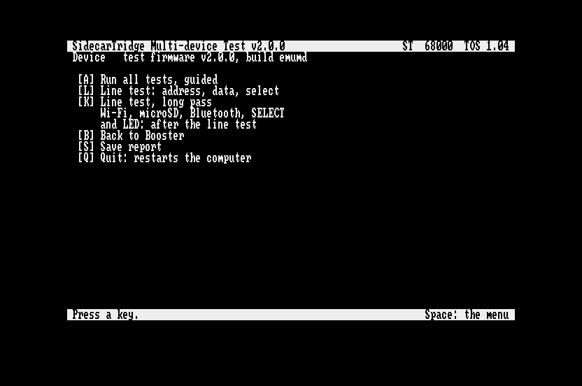

# SidecarTridge Multi-device Test

Tests a SidecarTridge Multi-device and its connection to an Atari ST, STE, Mega ST, Mega STE, TT or Falcon: every line of the cartridge port, the command channel, the microSD card, Wi-Fi, Bluetooth, the SELECT button and the green LED. At the end it says what works, what does not, and what to do about it.

It has two halves, released together:

- **The Multidevice Test microfirmware**, installed and launched from Booster (the Multi-device's own firmware, v2.0 or later). It fills the cartridge port with test data and puts no code on the Atari: the computer starts as if no cartridge were there.
- **`MDTEST.TOS`**, the test program, run on the Atari. One file: it needs no data file.

For a first look at the Multi-device itself, see the [SidecarTridge website](https://sidecartridge.com).

## What you need

- A SidecarTridge Multi-device running Booster, with Wi-Fi set up in Booster if you want the Wi-Fi test to reach the internet.
- An Atari ST, STE, Mega ST, Mega STE, TT or Falcon, with 512 KB of RAM or more (tested with TOS 1.04, 1.62, 2.06, 3.06 and 4.04). On a TT the program needs a colour monitor (it cannot draw TT high resolution). A Falcon works on an RGB or TV monitor, on VGA and on mono.
- A microSD card in the Multi-device, for the card test and to save the report (optional: without one the card test fails and the screen can be photographed instead).
- A way to get `MDTEST.TOS` onto the Atari (below).

## Getting started

### 1. Put the program on the Atari

Download from the [latest release](https://github.com/sidecartridge/md-testrom/releases/latest):

- **`MDTEST.TOS`**: copy it to a floppy, a hard disk, or any drive the Atari reads.
- **`MDTEST.ST`**: the same program in a floppy image, for a Gotek, a floppy written from the image, or an emulator.

Do not put it in the `AUTO` folder: quitting the program restarts the computer, so it would start again at every boot.

The program loads from any drive, without help from the Multi-device: a computer that cannot boot with the device in can still load it from a floppy (see [The Atari that will not boot with the device in](#the-atari-that-will-not-boot-with-the-device-in)).

### 2. Launch the Multidevice Test microfirmware

In Booster's web page (the Booster Configurator), find **Multidevice Test** in the apps, download it and launch it.


The device restarts with the test microfirmware and the Atari starts as if no cartridge were there.

### 3. Run the tests

Run `MDTEST.TOS` from the desktop.



Press **[A]** to run every test in order, then choose **[Q]** for the quick line test (about 2 minutes in all) or **[T]** for the thorough one (about 6 minutes). At the end the program asks whether to run the tests that need you: pressing SELECT, looking at the LED, and taking the microSD card out and back in.

A key between tests stops the run. The summary lists each area with PASS, WARN, FAIL, SKIP, LOCKED or not run, then what it means and what to do.

Each test also has its own key on the menu:

| Key | Test |
| --- | --- |
| [L] | Line test, quick pass: every data and address line and both ROM selects (about 22 s on an 8 MHz ST) |
| [K] | Line test, long pass: a million random reads |
| [M] | On a Mega STE: the quick pass at 8 MHz, 16 MHz and 16 MHz with the cache (your setting is put back) |
| [C] | Command channel test: the device answering the Atari's commands, thousands of them |
| [I] | Device information: firmware, board, clock, temperature, memory, why it last started |
| [P] | The SELECT button |
| [G] | The green LED: on, off and blinking, each one confirmed by you |
| [D] | microSD card: what card, its filesystem, a test file written, read back and deleted |
| [R] | microSD card out and back in |
| [W] | Wi-Fi: the radio, the networks heard, the network set up in Booster joined, the router, a name looked up, a web page fetched |
| [T] | Bluetooth: the controller, and the devices it hears |
| [B] | Back to Booster (shown when the test microfirmware answers) |
| [S] | Save the report |
| [Q] | Quit: Q twice restarts the computer |

[C] appears once a line test passes, and [I] to [T] once the command channel test passes too: when the port does not carry the data, nothing sent through it can be trusted. After a test its lines stay on the screen; press another test's key, or Space for the menu.

### 4. Save the report

**[S]** writes everything the program has shown to the microSD card in the Multi-device, as `MDTEST-REPORT-00.TXT` (then `-01`, `-02`...). It goes through the command channel, so it can be saved once the line test and the command channel test have passed; before that, photograph the screen. The program asks first whether to keep the names of the Wi-Fi networks and Bluetooth devices it heard.

## When something is wrong

The program says what it found in the port before anything else:

- **No Multi-device answers**: the device is not in the port, not powered, or not running. Switch the computer off, check the device is fully in, and launch the Multidevice Test from Booster.
- **Another microfirmware**: launch the Multidevice Test from Booster, then run the program again.
- **An old Multidevice Test** (v0.0.3): update the microfirmware in Booster (see [Upgrading from v0.0.3](#upgrading-from-v003)).
- **The microfirmware and the program are from different releases**: the program says which one to update. Use the `MDTEST.TOS` of the same release as the microfirmware.

When a line test fails, the program names the fault: a data line stuck or shorted to another, an address line, a select line, one byte lane, a whole bank not answering, the banks swapped, errors that come and go. Each finding comes with advice.

### What the line test cannot check

The line test checks the data lines D0-D15, the address lines A1-A15, the ROM4 and ROM3 select lines and the device's level shifters: a fault in any of them changes the words the Atari reads, and the program names the line. Some signals never change what a read returns, so no read from the Atari can test them:

- **UDS and LDS** (the byte strobes): the device always serves a whole word and the CPU picks the byte.
- **R/W**: the cartridge port is read-only.
- **The port's +5 V**, beyond the device working at all.
- **The SELECT button, the LED, the microSD card and the radio**: the device tests check these once the line test passes.

### The Atari that will not boot with the device in

The Multi-device can be set up without the Atari (*blind mode*):

1. Power on the Multi-device with a USB cable connected to a power source or a computer.
2. If you can reach Booster's web page, go to step 8.
3. If you cannot, reset the device to its factory settings: hold the SELECT button for more than 10 seconds.
4. Power the Multi-device off and on again. It starts in factory mode.
5. Connect to the `SIDECART` Wi-Fi network from a computer or a phone, with the password `sidecart`.
6. Open `http://192.168.4.1` in a web browser: Booster's web page. Choose your Wi-Fi network and enter its password. The device restarts and joins it.
7. The device is now at `http://sidecart.local`, or at its address on your network (your router's list of DHCP clients has it).
8. In Booster's web page, download the Multidevice Test and launch it.
9. Power the Multi-device off and connect it to the Atari. Remove the USB cable, so the Atari powers the device.
10. Power on the Atari. The Multi-device starts the test microfirmware, the Atari starts as if no cartridge were there, and you can run `MDTEST.TOS` from a floppy.

## Back to Booster

Either:

- choose **[B] Back to Booster** in `MDTEST.TOS`: the device restarts into Booster, and a key restarts the computer into it; or
- press the **SELECT** button on the Multi-device (except during the SELECT button test, which only reports the press).

Holding SELECT for 10 seconds resets the device to its factory settings.

## Upgrading from v0.0.3

v0.0.3 was a different pair: the program `TESTSCRT.TOS` with its data file `TESTROM.BIN`. Neither works with this microfirmware.

1. In Booster, update the Multidevice Test microfirmware (or download it again) and launch it.
2. On the Atari, delete `TESTSCRT.TOS` and `TESTROM.BIN`, and copy the new `MDTEST.TOS`.

`MDTEST.TOS` recognises a device still running v0.0.3 and says to update it.

## Building from source

The microfirmware and the program build together:

```
git clone https://github.com/sidecartridge/md-testrom.git
cd md-testrom
./build.sh pico_w release <APP_UUID>
```

`dist/` then holds the microfirmware (`<APP_UUID>-<VERSION>.uf2` and `<APP_UUID>.json`) and `MDTEST.TOS`.

You need:

- The ARM GNU Toolchain 14.2 (`arm-none-eabi-gcc` on the `PATH`, or `PICO_TOOLCHAIN_PATH`), CMake 3.26 or later, Python 3 and `git`.
- The [atarist-toolkit-docker](https://github.com/sidecartridge/atarist-toolkit-docker) 1.5.0 (`stcmd`), for the Atari program.

The build fetches its submodules (the Raspberry Pi Pico SDK, pico-extras and FatFs) and pins them to their tested versions. `<APP_UUID>` is the app's identity in Booster; without one, the build uses a development UUID.

## License

This project is licensed under the GNU General Public License v3.0. See the [LICENSE](LICENSE) file for details.
